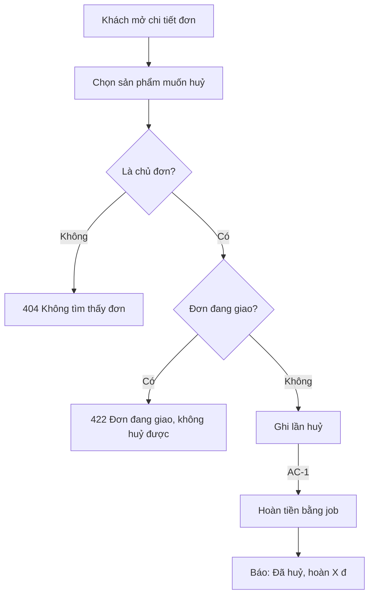
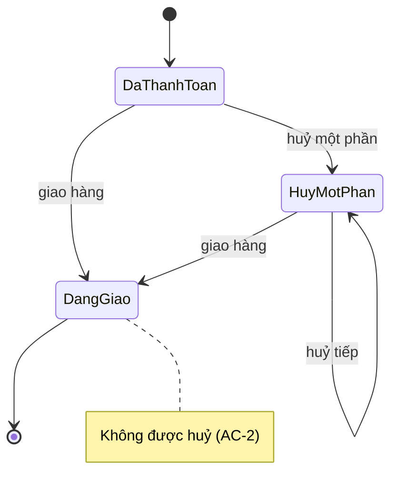
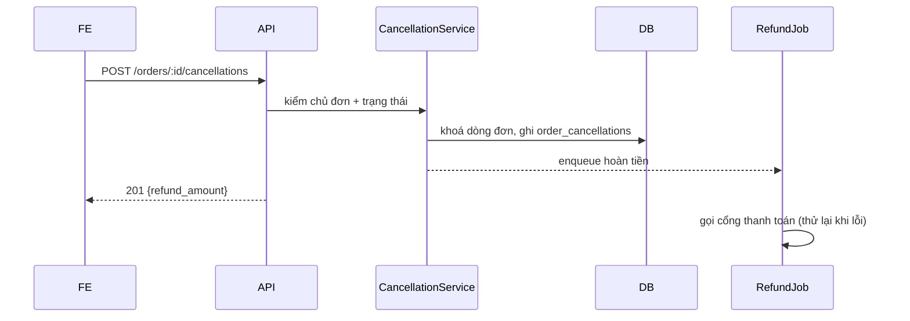

# Báo cáo task `20261119-huy-don-mot-phan`

> Tạo bằng `board.py report` lúc 2026-11-19 04:19. Nguồn: board SQLite + `TASK.md`. Không sửa tay, chạy lại lệnh để cập nhật.

## Giả định cần client xác nhận

> [!CAUTION]
> **🔴 3 giả định cần client xác nhận.** Khi yêu cầu chưa rõ, team đã tự chọn cách hiểu dưới đây để không dừng việc. Vui lòng đánh dấu **Đúng / Sai** từng dòng; sai thì ghi cách đúng, team sẽ sửa.

| # | 🔴 Điểm chưa rõ | Team đã chọn (vì sao) | Phương án khác đã xét | Ưu | Nhược | Nếu sai thì | Mức ảnh hưởng | Client xác nhận |
|---|---|---|---|---|---|---|---|---|
| A-1 | 🔴 **Sản phẩm có khuyến mãi chia đều cho cả đơn thì hoàn bao nhiêu?** | **Hoàn theo giá sau khi đã phân bổ khuyến mãi cho từng sản phẩm** · Khách không được lợi khi huỷ bớt; phát hiện khi code (G-1) | Hoàn theo giá gốc; thu hồi toàn bộ khuyến mãi khi huỷ | Công bằng, đúng số tiền khách thực trả | Khách có thể thấy số hoàn thấp hơn giá niêm yết | Đổi công thức hoàn + kiểm lại các đơn đã hoàn | Cao | ☐ Đúng ☐ Sai: …… |
| A-2 | 🔴 **Phí vận chuyển có được hoàn khi huỷ một phần?** | **Không hoàn phí vận chuyển** · Đơn vẫn giao phần còn lại; quy tắc phí chưa có trong KB. Lead chốt sau 2 lần trả lời (WHY-2) | Hoàn theo tỷ lệ số sản phẩm huỷ (BA đề xuất) | Đơn giản, không đổi cách tính phí cũ | Khách huỷ gần hết đơn vẫn mất trọn phí, dễ bị phàn nàn | Sửa RefundCalculator + 1 test, ~0.5 ngày | Trung bình | ☐ Đúng ☐ Sai: …… |
| A-3 | 🔴 **Được huỷ một phần tới lúc nào?** | **Tới khi đơn chuyển sang "Đang giao"** · Sau lúc này hàng đã rời kho, huỷ sẽ lệch tồn kho | Cho huỷ tới khi giao xong, nhận hàng hoàn | Không lệch tồn kho, luồng kho không đổi | Khách không huỷ được khi hàng đang trên đường | Đổi 1 điều kiện trạng thái (Order#partially_cancellable?) | Thấp | ☐ Đúng ☐ Sai: …… |

## Thiết kế: workflow và màn hình (client xác nhận)

### W-1 · Workflow nghiệp vụ (`design/workflow.md`)

☐ Đúng ý ☐ Chưa đúng: ……

### W-2 · Sơ đồ trạng thái (`design/state.md`)

☐ Đúng ý ☐ Chưa đúng: ……

### W-3 · Sơ đồ kỹ thuật (sequence) (`design/sequence.md`)

☐ Đúng ý ☐ Chưa đúng: ……

- M-1 · Màn hình **Huỷ một phần đơn hàng**: mở `design/mockup-huy-mot-phan.html` bằng trình duyệt · ☐ Đúng ý ☐ Chưa đúng: ……

## 1. Kết quả

| Mục | Giá trị |
|---|---|
| Loại | VỪA (đổi API huỷ đơn + bảng mới, 1 service) |
| Phương án chốt | B (bảng order_cancellations) + ý hoàn tiền bất đồng bộ của C |
| Workflow | YES |
| UI mockup | YES |
| Security duyệt solution | APPROVED |
| Kết quả test | PASS |
| Lint/format | PASS |
| Gap còn mở | 0 |
| Code review | APPROVED |
| Security review | APPROVED |
| Cập nhật KB | YES |
| Bài học | YES |

**Yêu cầu gốc:**

> Khách đã thanh toán muốn huỷ bớt vài sản phẩm trong đơn. Hệ thống phải hoàn tiền đúng phần huỷ, đơn vẫn giao phần còn lại.

## 2. Debate qua số liệu

| Chỉ số | Giá trị |
|---|---|
| Team debate | business-analyst, lead, security, solution-architect, test-designer |
| Số lượt | 5 |
| Số bài post | 22 |
| WHY đã hỏi | 5 |
| WHY cả team đồng ý | 4 |
| WHY Lead phán quyết / Assumption | 0 / 1 |
| WHY còn mở | 0 |
| Tổng số lần trả lời WHY | 6 |
| Số phiếu DISAGREE | 2 |

| Role | Bài post | WHY đã hỏi | WHY bị hỏi | AGREE | DISAGREE |
|---|---|---|---|---|---|
| business-analyst | 4 | 2 | 1 | 3 | 2 |
| lead | 4 | 0 | 0 | 4 | 0 |
| security | 5 | 1 | 0 | 4 | 0 |
| solution-architect | 4 | 0 | 4 | 1 | 0 |
| test-designer | 5 | 2 | 0 | 4 | 0 |

## 3. Diễn biến từng lượt

| Lượt | Mục tiêu | Ai post (số bài) | Tóm tắt của Lead |
|---|---|---|---|
| S2-R1 | Đề xuất phương án + AC | solution-architect (1), business-analyst (1) | SA đưa A/B/C, BA viết AC-1..3. |
| S2-R2 | Hỏi WHY | business-analyst (1), test-designer (1), security (1) | 5 WHY mở, chủ yếu hỏi Architect. |
| S2-R3 | Trả lời WHY + biểu quyết | solution-architect (2), business-analyst (1), test-designer (4), security (4), lead (4) | WHY-1,3,4,5 thống nhất. WHY-2 BA chưa đồng ý. |
| S2-R4 | Giằng co WHY-2 | solution-architect (1), business-analyst (1) | WHY-2 Lead chốt Assumption. Hết WHY, mở chấm điểm. |
| S2-R5 | Chấm điểm (kín, trả về Lead) | - | - |

## 4. WHY: câu hỏi, kết luận, ai đồng ý

| WHY | Hỏi → | Câu hỏi | Kết luận cuối | Lần trả lời | Đồng ý | Không đồng ý (lý do, lần trả lời) | Trạng thái |
|---|---|---|---|---|---|---|---|
| WHY-1 | business-analyst → solution-architect | Vì sao A đủ khi khách huỷ nhiều lần trên cùng một sản phẩm? | Đúng, A chỉ lưu tổng số đã huỷ, mất lịch sử từng lần (order_items không có cột thời gian huỷ). Đề xuất bỏ A, nghiêng về B. | 1 | business-analyst, lead, security, test-designer | - | agreed |
| WHY-2 | business-analyst → solution-architect | Vì sao phí vận chuyển không tính trong cả 3 phương án? | Huỷ toàn bộ phần còn lại là huỷ đơn, đã có luồng cũ hoàn phí. Huỷ một phần thì không hoàn phí. · assumption bởi Lead: Không hoàn phí vận chuyển khi huỷ một phầ… | 2 | - | business-analyst: Vì sao không hoàn phí khi huỷ toàn bộ sản phẩm còn lại? (lần 1); business-analyst: Vì sao không hoàn một phần phí theo tỷ lệ sản phẩm huỷ? (lần 2) | assumption |
| WHY-3 | test-designer → solution-architect | Vì sao hoàn tiền phải đồng bộ trong request? | Không cần đồng bộ: gọi cổng thanh toán có thể chậm 5-10s, nên đẩy vào job như C. | 1 | business-analyst, lead, security, test-designer | - | agreed |
| WHY-4 | test-designer → business-analyst | Vì sao AC không có case 2 request huỷ cùng lúc? | Thiếu thật, thêm AC-4: huỷ lần 2 được phép, khoá dòng đơn khi huỷ. | 1 | lead, security, solution-architect, test-designer | - | agreed |
| WHY-5 | security → solution-architect | Vì sao API tìm đơn bằng id mà không giới hạn theo chủ đơn? | Sẽ dùng current_user.orders.find, không tìm toàn bảng (giống app/controllers/orders_controller.rb:18). | 1 | business-analyst, lead, security, test-designer | - | agreed |

## Phương án (TASK.md mục 3)

### A. Thêm cột cancelled_qty vào order_items
- Mô tả: Mỗi dòng sản phẩm có thêm cột số lượng đã huỷ; hoàn tiền gọi cổng thanh toán ngay trong request.
- Ưu: Ít thay đổi nhất, không thêm bảng, làm nhanh.
- Nhược: Mất lịch sử từng lần huỷ, không cộng dồn được nhiều lần (WHY-1).
- Rủi ro: Request treo 5-10s khi cổng thanh toán chậm.
- Kết luận: Loại, không đáp ứng AC-4.
### B. Bảng mới order_cancellations (mỗi lần huỷ 1 dòng)
- Mô tả: Mỗi lần huỷ ghi 1 dòng (sản phẩm, số lượng, số tiền hoàn), khoá dòng đơn khi huỷ.
- Ưu: Giữ lịch sử, cộng dồn được (AC-4), dễ đối soát.
- Nhược: Thêm 1 bảng, 1 migration.
- Rủi ro: Thấp; cần index (order_id).
- Kết luận: Chọn làm nền.
### C. Huỷ đơn cũ, tạo đơn mới với phần còn lại
- Mô tả: Huỷ toàn bộ đơn cũ, tạo đơn mới chứa phần còn lại; hoàn tiền bằng job nền.
- Ưu: Không đổi schema; hoàn tiền qua job không làm treo request.
- Nhược: Đổi mã đơn, khách và CSKH khó theo dõi.
- Rủi ro: Báo cáo doanh thu đếm trùng đơn.
- Kết luận: Loại, nhưng lấy ý hoàn tiền bằng job vào B.

## Bảng điểm (TASK.md mục 5)

| Tiêu chí | Trọng số | A | B | C |
|---|---|---|---|---|
| Đáp ứng AC | ×3 | 2 | 5 | 4 |
| Ít ảnh hưởng code cũ | ×3 | 4 | 4 | 2 |
| Bảo mật | ×3 | 4 | 4 | 3 |
| Hiệu năng / mở rộng | ×2 | 4 | 4 | 3 |
| Dễ maintain / test | ×1 | 3 | 5 | 2 |
| Công sức | ×1 | 5 | 3 | 2 |
| **Tổng** | | 46 | 56 | 39 |

## Phương án chốt (TASK.md mục 6)

- **Cách chốt:** gộp
- **Giải pháp:** B làm nền (bảng order_cancellations), lấy ý hoàn tiền bất đồng bộ qua job của C.
- **Nếu gộp:** data model từ B (solution-architect), job hoàn tiền từ C (solution-architect, test-designer đồng ý vì test được bằng job đồng bộ trong test). Bỏ phần đổi mã đơn của C vì khách khó theo dõi.
- **Security duyệt nhanh:** APPROVED

## Ý kiến từng role (TASK.md mục 7)

| Role | Ủng hộ | Ý kiến chính | Chấp nhận / Bác | Lý do |
|---|---|---|---|---|
| BA | B | A không đáp ứng AC-4 (huỷ nhiều lần) | Chấp nhận | WHY-1 cả team đồng ý |
| Architect | B + job của C | Hoàn tiền gọi cổng thanh toán nên để job | Chấp nhận | WHY-3 |
| Test Design | B | Cần case huỷ song song 2 request | Chấp nhận | WHY-4, thêm AC-4, test khoá dòng |
| Security | B | API chỉ tìm đơn trong phạm vi chủ đơn | Chấp nhận | WHY-5 |

Ý kiến thiểu số bị bác: business-analyst muốn hoàn phí vận chuyển theo tỷ lệ (WHY-2), Lead chọn Assumption "không hoàn", ghi ở mục 2.

## Phán quyết của Lead (TASK.md mục 8)

| Issue | 2 bên | Quyết định | Lý do |
|---|---|---|---|
| WHY-2 phí vận chuyển | BA (hoàn) vs Architect (không hoàn) | Không hoàn, ghi Assumption | 2 lần trả lời không có dữ kiện mới, quy tắc phí chưa có trong KB |

## Gap phát hiện khi làm (TASK.md mục 14)

| ID | Thiếu gì | Báo bởi | Loại | Người debate | Quyết định | Vì sao S1-S2 bỏ sót | Bài học | Trạng thái |
|---|---|---|---|---|---|---|---|---|
| G-1 | Huỷ sản phẩm có khuyến mãi chia đều thì hoàn bao nhiêu? | backend-dev | Nghiệp vụ / AC | business-analyst, test-designer | Hoàn theo giá sau khuyến mãi đã phân bổ | AC thiếu case khuyến mãi | YES | Closed |

## Kết quả test (TASK.md mục 10)

| AC | Test | PASS / FAIL / BLOCKED / NOT RUN |
|---|---|---|
| AC-1 | spec/requests/order_cancellations_spec.rb "AC-1 huỷ 1 sản phẩm" | PASS |
| AC-2 | "AC-2 đơn đã giao" | PASS |
| AC-3 | "AC-3 không phải chủ đơn → 404" | PASS |
| AC-4 | "AC-4 huỷ lần 2 cộng dồn" | PASS |

## Kết quả review (TASK.md mục 11)

| Loại | Critical | High | Medium | Low | Kết luận |
|---|---|---|---|---|---|
| Code | 0 | 0 | 1 | 2 | APPROVED |
| Security | 0 | 0 | 0 | 1 | APPROVED |
