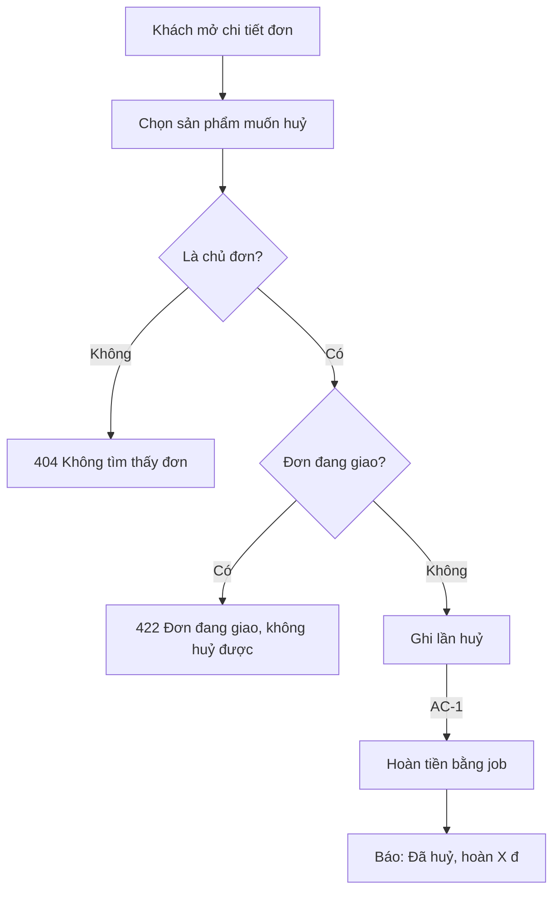
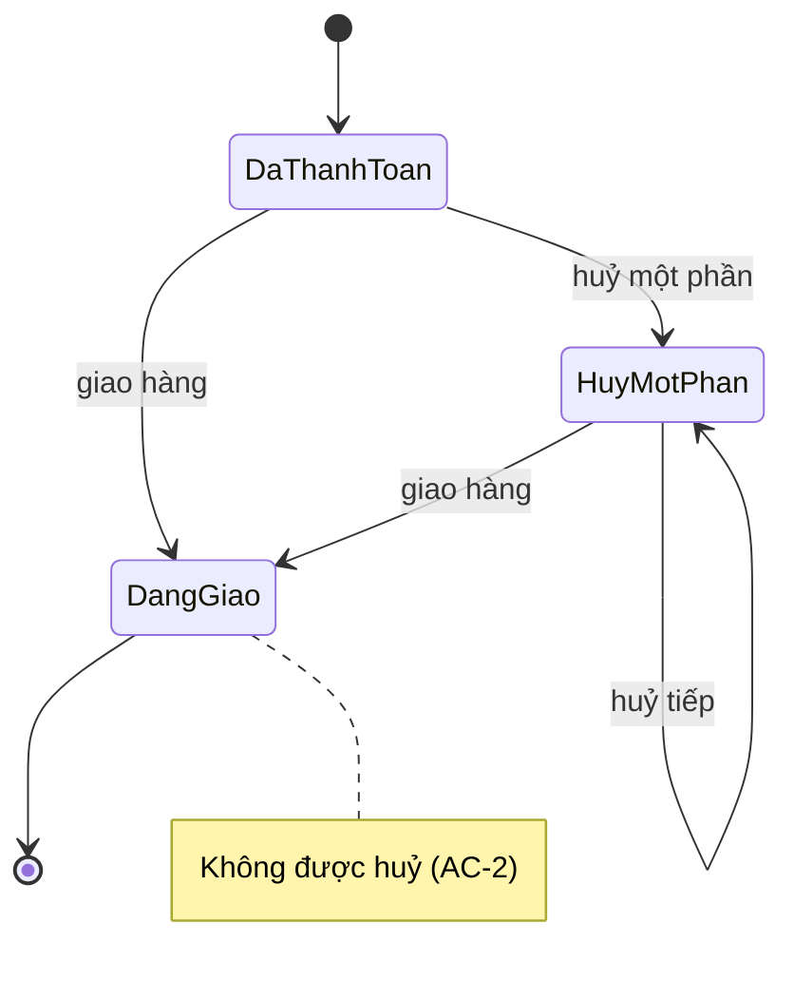
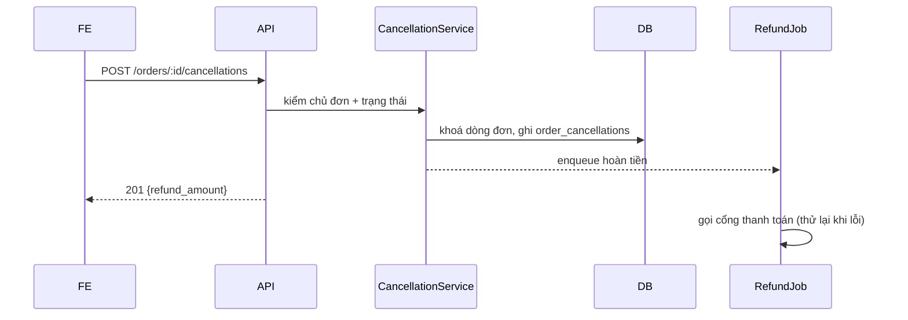

# Sơ đồ Mermaid của task

| File | Ai viết | Dùng để | Loại Mermaid |
|---|---|---|---|
| `design/workflow.md` | BA | Người dùng làm gì, hệ thống phản hồi, rẽ nhánh lỗi / không có quyền | `flowchart TD` |
| `design/state.md` | BA (chỉ khi task đổi trạng thái dữ liệu) | Trạng thái và chuyển trạng thái được / bị cấm | `stateDiagram-v2` |
| `design/sequence.md` | Architect | Thành phần gọi nhau theo thứ tự: FE, API, service, DB, job, bên thứ ba | `sequenceDiagram` |

Mỗi file: tiêu đề `#`, 1-3 dòng giải thích, một khối ` ```mermaid `, sau đó ghi chú ngắn (AC liên quan, điểm cần chú ý). `board.py report` vẽ sẵn thành hình trong REPORT.html.

## Quy tắc chung
- Chữ trong sơ đồ là **tiếng Việt, ngắn**, đặt trong dấu ngoặc kép khi có dấu câu: `A["Bấm Huỷ"]`.
- Mỗi nhánh lỗi / không có quyền là một nút riêng, ghi rõ hệ thống trả gì (mã lỗi / thông báo).
- Gắn AC vào nút hoặc cạnh liên quan: `-->|AC-2| E`.
- Tối đa ~20 nút mỗi sơ đồ; dài hơn thì tách theo bước.
- Không đưa secret, dữ liệu thật của khách.

## Mẫu



