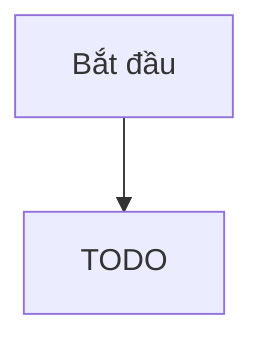

# Luồng nghiệp vụ

> BA vẽ theo skill `agent-team:diagrams`. Mỗi luồng: `## F-n: <tên>`, 1 sơ đồ Mermaid, 1 bảng bước.
> Cột "Nếu lỗi / ngoại lệ" không được trống (không có thì ghi "Không có: <vì sao>").
> Nên có luồng "1 ngày của <vai trò>" cho mỗi vai trò chính, để owner bấm thử theo.

## F-1: TODO

| Bước | Ai | Hành động | Nếu lỗi / ngoại lệ |
|---|---|---|---|
| 1 | | | |
